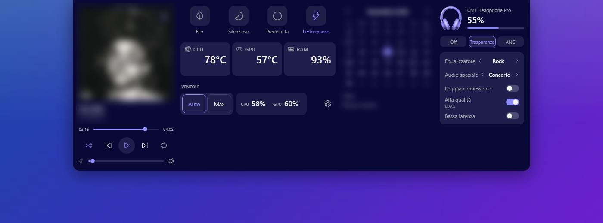
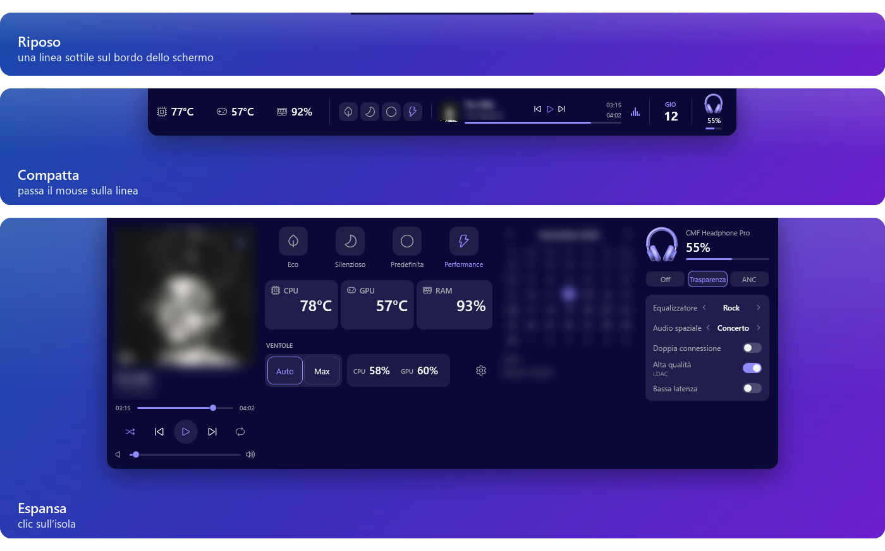
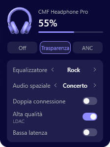
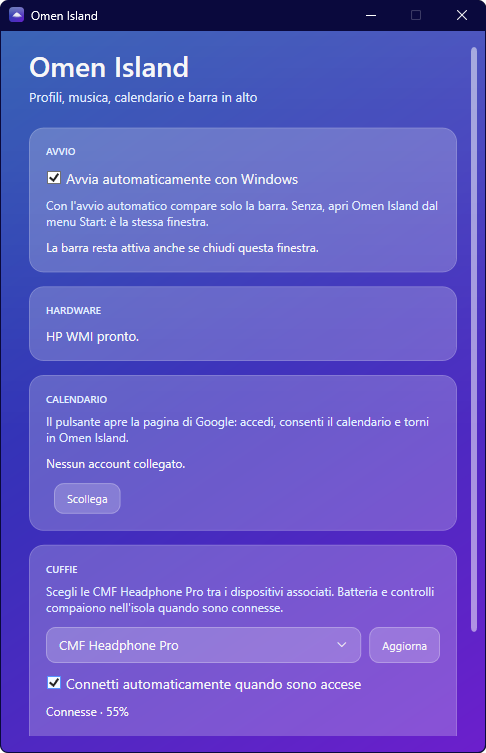

<div align="center">

# Omen Island

**Una dynamic island per i portatili HP OMEN e Victus.**
Temperature, profili, ventole, musica, calendario e cuffie in una barra discreta in cima allo schermo.




</div>

---

## Perché

OMEN Gaming Hub è pesante e sta in una finestra a parte. Omen Island fa le cose che servono ogni giorno, dove servono: a un passaggio del mouse dal bordo alto dello schermo.

- **Discreta.** A riposo è una linea di pochi pixel. Si apre solo quando ci vai sopra.
- **Leggera.** Un solo eseguibile .NET, nessun servizio in background, nessun driver kernel.
- **Indipendente.** Parla direttamente con il firmware HP via WMI. Non usa né include codice di OmenMon od OMEN Gaming Hub.

## Tre stati, un gesto



| Stato | Come ci arrivi | Cosa mostra |
|---|---|---|
| **Riposo** | sempre | una linea sottile sul bordo alto, nel colore della barra delle applicazioni |
| **Compatta** | passi il mouse sulla linea | temperature CPU/GPU, RAM, profilo attivo, brano in riproduzione con spettro audio, prossimo evento, batteria delle cuffie |
| **Espansa** | clic sull'isola | player completo, pannello prestazioni, calendario del mese, controlli delle cuffie |

`Esc` o il mouse che esce dall'isola la riportano a riposo. Le icone, i cursori e lo spettro prendono il colore d'accento dello sfondo di Windows, così l'isola si intona al desktop.

## Funzionalità

### Prestazioni

- **Profili termici** Eco, Silenzioso, Predefinita e Performance, con un clic.
- **Ventole** Auto o Max.
- **Temperature** CPU e GPU in tempo reale, con l'uso della RAM.
- **Sicurezza prima di tutto.** Il primo comando al firmware chiede una conferma esplicita. All'uscita, in sospensione o se i dati dei sensori smettono di arrivare, l'app riporta le ventole in Auto.

### Musica

- Funziona con qualsiasi app che usa i controlli multimediali di Windows: Spotify, YouTube nel browser e altre.
- Copertina, titolo, avanzamento, play/pausa, brano precedente/successivo, riproduzione casuale, ripetizione e volume dell'app.
- Nella vista compatta, uno spettro a 36 barre segue l'audio in tempo reale.

### Calendario

- Calendario Google in sola lettura nella vista espansa, con gli eventi del giorno.
- Il prossimo evento compare anche nella vista compatta.

### Cuffie CMF Headphone Pro



Le cuffie si collegano direttamente via Bluetooth, senza l'app Nothing X:

- batteria nella vista compatta e in quella espansa;
- cancellazione del rumore: Off, Trasparenza, ANC con livello;
- equalizzatore con preset ed equalizzatore personalizzato a tre bande (bassi, medi, alti);
- audio spaziale (Concerto, Cinema), doppia connessione, LDAC e bassa latenza.

L'immagine delle cuffie prende il colore d'accento come il resto dell'isola. La colonna compare solo quando le cuffie sono connesse.

<br clear="right">

### Impostazioni e area di notifica



- **Avvio con Windows** con un solo prompt UAC la prima volta. Ai riavvii successivi parte in silenzio.
- **Account Google** per il calendario.
- **Scelta delle cuffie** tra i dispositivi Bluetooth associati.
- **Menu dell'area di notifica** nello stesso stile delle impostazioni, con profilo e ventole correnti. Contiene **Riavvia island**, che ricrea solo la barra senza fermare il resto, e il ripristino rapido delle ventole in Auto.

<br clear="right">

## Compatibilità

| | |
|---|---|
| **Sistema** | Windows 10 o 11, x64 |
| **Portatile di riferimento** | HP Victus 16-e0xxx (scheda 88EC), Ryzen 5 5600H, RTX 3050 |
| **Altri modelli** | Gli altri HP OMEN e Victus vengono riconosciuti all'avvio. I comandi al firmware dipendono dal modello. |
| **Cuffie** | CMF Headphone Pro. Le altre cuffie Bluetooth funzionano come normali dispositivi audio, senza controlli nell'isola. |
| **Permessi** | Senza diritti di amministratore l'app è in sola lettura. I comandi al firmware e alcune temperature richiedono l'elevazione. |

## Installazione

Per ora non ci sono build pubblicate: Omen Island si compila dai sorgenti. Serve l'[SDK .NET 8](https://dotnet.microsoft.com/download/dotnet/8.0).

```powershell
git clone https://github.com/federicocattelan/OmenIsland.git
cd OmenIsland
dotnet build .\src\OmenIsland.App\OmenIsland.App.csproj -c Release -o "$env:LOCALAPPDATA\OmenIsland\App"
```

Avvia `OmenIsland.App.exe` come amministratore. Nelle impostazioni attiva **Avvia automaticamente con Windows**: l'app registra un'attività pianificata. Dai riavvii successivi l'isola parte da sola e senza prompt.

Puoi riaprire le impostazioni dal menu Start (cerca **Omen Island**) o con un doppio clic sull'icona nell'area di notifica.

### Calendario Google (facoltativo)

Il calendario usa un client OAuth tuo:

1. Crea un client OAuth "App desktop" su Google Cloud con l'API Google Calendar abilitata.
2. Copia `src/OmenIsland.App/Services/Calendar/GoogleSignIn.Local.cs.example` in `GoogleSignIn.Local.cs` e inserisci ID e secret del client.
3. Ricompila. Nelle impostazioni, **Collega account Google** apre la pagina di accesso di Google.

`GoogleSignIn.Local.cs` è escluso da git. Senza questo file l'app funziona lo stesso, solo senza calendario.

## Sicurezza e privacy

- **Nessun driver kernel.** L'app non installa WinRing0, PawnIO o simili. Le letture passano da WMI e da LibreHardwareMonitor.
- **Il firmware è toccato solo su tua richiesta.** Serve un consenso esplicito la prima volta, e una temperatura alta non forza mai le ventole al massimo da sola.
- **Tutto resta sul PC.** Il calendario è in sola lettura e il token resta sul computer. Le impostazioni sono in `%LOCALAPPDATA%\OmenIsland\settings.json` e non c'è telemetria.
- **Log diagnostici locali.** L'isola e le cuffie scrivono in `%LOCALAPPDATA%\OmenIsland` (`island.log`, `headphones.log`, al massimo 256 KB ciascuno). Il menu dell'area di notifica ti ricorda che sono attivi e apre la cartella con un clic.

## Domande frequenti

**L'isola è sparita, cosa faccio?**
Usa **Riavvia island** dal menu dell'area di notifica. Di solito non serve: l'isola si risistema da sola dopo cambi di schermo, sblocco e risveglio, e lo annota in `island.log`.

**La temperatura della CPU resta a 0 o non compare.**
Su Ryzen il sensore diretto spesso non risponde senza driver. In quel caso l'app usa le zone termiche ACPI, che richiedono l'avvio come amministratore.

**La bassa latenza delle cuffie si spegne da sola.**
È il firmware delle CMF Headphone Pro: la spegne a ogni nuova connessione, anche con l'app Nothing X.

**Posso controllare la velocità delle ventole in percentuale?**
No, di proposito. Sul firmware di riferimento le modalità affidabili sono Auto e Max.

## Sviluppo

```powershell
dotnet build .\OmenIsland.sln
dotnet test .\OmenIsland.sln
```

| Progetto | Contenuto |
|---|---|
| `src/OmenIsland.App` | isola WPF, stati e layout, musica, calendario, cuffie, impostazioni, area di notifica, avvio automatico |
| `src/OmenIsland.Hardware` | trasporto HP WMI, telemetria, comandi di profili e ventole, politica termica |
| `tests/OmenIsland.Tests` | protocolli (HP WMI, Nothing), layout, stati, politica termica, musica e calendario |

[`AGENTS.md`](AGENTS.md) descrive il comportamento atteso in dettaglio: stati, colori, protocolli, avvio e cose da non cambiare. Leggilo prima di modificare il codice.

## Note legali

Omen Island è un progetto indipendente. Non è affiliato, approvato o supportato da HP Inc., Nothing Technology o CMF. OMEN, Victus, Nothing e CMF sono marchi dei rispettivi proprietari. I comandi al firmware sono inviati a tuo rischio.

Distribuito con licenza [Apache 2.0](LICENSE).
